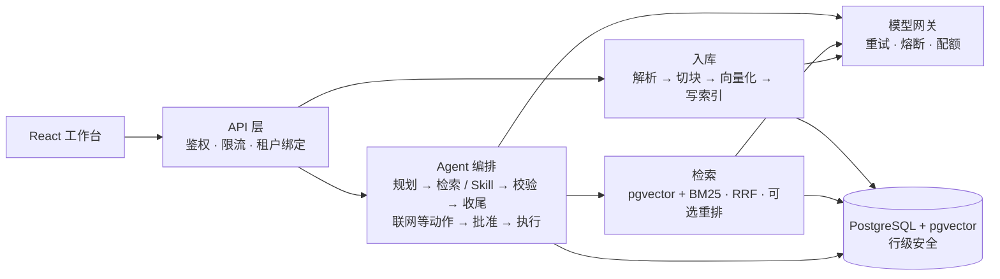

<div align="center">

# Luc1ferxx Archive RAG

**可信文档智能体：上传 PDF、Word、PowerPoint 或 Excel 文件后提问、对比、审查，文档回答附带页、幻灯片、工作表或章节级的出处；Agent 会逐条核对普通文档问答，核对不过时补检索、澄清或拒答（有例外，也有漏放和误拒，见[当前限制](#当前限制)）。**

<p>
  <a href="https://github.com/luc1ferxx/Luc1ferxx_Archive_RAG/actions/workflows/quality-gate.yml"></a>
  <a href="https://github.com/luc1ferxx/Luc1ferxx_Archive_RAG/actions/workflows/real-model-eval.yml"></a>
</p>

[快速开始](#快速开始) · [架构](#架构) · [实测结果](#实测结果) · [文档](#文档) · [当前限制](#当前限制)

</div>

## 它是一个什么样的 Agent

一个受控的"规划-执行"Agent，只有一种运行时（LangGraph.js）：

- **模型决定什么**：在运行时给出的候选里选意图和步骤；也能用最多两次只读 Skill 调用编一张小图，最多重规划一次。意图候选由关键词规则生成。没有让模型自由选工具的循环，也没有用原生 tool calling。
- **运行时决定什么**：权限、文档范围、预算、并发、审批，以及失败的步骤能不能重放。
- **现在做到什么程度**：用本地 7B 模型（`qwen2.5:7b`，不是默认配置的 gpt-5）在同一批 QASPER 题（176 道可答、24 道不可答）上测：默认流程的 Agent 答了 61 道可答题、误答 3 道不可答题；纯文档 RAG 是 101 和 10（在较早的提交上测的）。答了不等于答对；多步任务的成功率还没有用真实模型测过。
- **怎么做出来的**：早期用过 Codex（2026 年 4–7 月有 4 个它的 PR）；7 月下旬起主要是 Claude Code，9 月以来几乎每个提交都有它的署名，这期间的代码、测试、问题排查、评测和文档基本由它完成。作者定方向并拍板：只保留一种运行时是作者提出的要求；默认打开 claim 评审、让重排保持可选，是作者看过它给的数据和建议后的决定。

## 它能做什么

- **多种格式**：PDF、Word（.docx）、PowerPoint（.pptx）和 Excel（.xlsx）。PDF 按页定位，PowerPoint 按幻灯片（含标题和演讲者备注），Excel 按工作表（每行按表头标注），Word 按章节（按文档里最高一级的标题切分）。旧版 .doc / .ppt / .xls、设了打开密码的文件和启用宏的文件不收；`RAG_DOCUMENT_FORMATS=pdf` 时只收 PDF。
- **带出处的问答**：在选中的文档或整个工作区里提问，回答附带位置（页码，或幻灯片、工作表、章节）、摘录和来源文件。
- **多文档对比**：每份文档单独检索，差异绑定到各自的出处，也能识别"没有实质差异"。
- **逐条核对证据（Agent 路线）**：逐条检查普通文档问答（不带联网）的结论有没有证据支持，不够时补检索一轮，仍不够时请用户澄清、删去没有证据的句子或拒答；核对会有漏放和误拒，其他路径只做一部分或不做，见[当前限制](#当前限制)。
- **可审批、部分可恢复的 Agent 运行**：用 PostgreSQL 时，运行、审批和检查点会持久化。重启后，计划只含 Skill 图、中断时没有节点在执行、状态也对得上的运行会从检查点续跑；中断的普通文档问答不续跑，只标记为待人工处理，要重问；后台任务会自动重跑。Agent 要联网搜索、导入、建待办或保存产物时，需要先批准（缺口见[当前限制](#当前限制)）。
- **多租户**：PostgreSQL 行级安全兜底，可选 OIDC 登录、RBAC、租户配额、租户数据导出和删除、原始文件加密。
- **按需扩展**：默认一个进程加一个 PostgreSQL；可以异步入库、多实例、按层拆分部署，也能作为只读的 MCP server 给其他 Agent 调用（它的 `ask` 走纯文档 RAG，不做 Agent 的逐条核对）。

## 快速开始

**Docker 一键部署**（API、前端和 PostgreSQL 一起启动，打开 http://localhost:5001）：

```bash
cp server/.env.example server/.env   # 至少填 OPENAI_API_KEY，或按下面改用本地模型
docker compose --profile app up -d --build
```

端口默认只绑定 `127.0.0.1`。要在局域网里访问，先改数据库密码、开启 API 鉴权并配置自己的 token，见 [docs/deployment.md](docs/deployment.md#端口与网络暴露)。

**本地开发**（Node 22.13 及以上）：

```bash
npm install && (cd server && npm install)
cp .env.example .env && cp server/.env.example server/.env
docker compose up -d   # 只启动 PostgreSQL 16 + pgvector
npm run dev            # 前端 http://localhost:3000，后端 http://localhost:5001
```

**用本地模型（不花钱）**：装好 [Ollama](https://ollama.com)，`ollama pull qwen2.5:7b` 和 `ollama pull nomic-embed-text`，然后在 `server/.env` 里设置：

```env
OPENAI_API_KEY=ollama
OPENAI_BASE_URL=http://127.0.0.1:11434/v1
OPENAI_CHAT_MODEL=qwen2.5:7b
OPENAI_EMBEDDING_MODEL=nomic-embed-text
RAG_EMBEDDING_DIMENSIONS=768
```

用 Docker 部署时，`OPENAI_BASE_URL` 要写成 `http://host.docker.internal:11434/v1`（容器里的 127.0.0.1 不是本机）。

**常用开关**（完整列表见 [docs/configuration.md](docs/configuration.md)）：

| 开关 | 作用 |
| --- | --- |
| `DOCCOMPARE_STANDALONE=1` | 不连 PostgreSQL 单机试用：文档存本地文件，运行记录和任务只在内存里，不做租户隔离 |
| `RAG_INGEST_MODE=async` | 上传立即返回 202，由后台 worker 入库 |
| `RAG_DOCUMENT_FORMATS=pdf` | 只收 PDF，上传的检查和报错和加入 Office 格式之前一样（默认 PDF、Word、PowerPoint、Excel 都收；压缩包和单元格上限见 [docs/configuration.md](docs/configuration.md#文档格式)） |
| `PDF_PARSER=auto` | 表格页和扫描页交给 Docling，其余页用 pdf.js（需要 docling-serve，见 [docs/deployment.md](docs/deployment.md#版面解析可选)） |
| `RAG_RERANK_ENABLED=true` + `RAG_RERANK_PROVIDER=cross-encoder` + `RAG_CROSS_ENCODER_ENDPOINT` | 交叉编码器重排（需要重排服务，见 [docs/deployment.md](docs/deployment.md#交叉编码器重排可选推荐)） |
| `API_AUTH_ENABLED=true` + `API_AUTH_TOKENS` | 按 token 鉴权并区分用户和 workspace；OIDC 和 RBAC 见 [docs/deployment.md](docs/deployment.md#oidc-登录和-rbac可选) |
| `ARCHIVE_RAG_ROLE=api\|agent\|retrieval\|model-gateway` | 按层拆分部署时这个进程跑哪一层，还要配服务地址和层间密钥，见 [docs/deployment.md](docs/deployment.md#拆分部署可选) |

## 架构



一次请求：API 鉴权并绑定租户 → 规划器在白名单内选意图和步骤，然后主要走三类路径：

- **普通文档问答**：检索、作答，再逐条核对（先按词法规则，被拒的一部分由 LLM 评审复核；对比不用 LLM 复核）。核对不过时补检索一轮，仍不过时一般改为请用户澄清。
- **Skill 和研究简报**：收尾时只做词法核对，不补检索。
- **联网搜索等要审批的动作**：批准后执行，结果不做 claim 校验。

流式草稿只含通过词法核对的整句，之后仍可能被最终结果替换；最终事件里也可能带着没通过核对的原文（见[当前限制](#当前限制)）。

几条设计原则：

- **模型只提议，运行时做决定**：权限、文档范围、预算、审批和并发都由运行时决定，规划器只能在白名单里选。
- **循环有上限**：补检索最多一轮，重规划最多一次；每次运行还有 token、成本（只对有定价的模型）和时长三个软上限，在步骤边界检查，超限时降级而不是报错，不中断进行中的模型调用。
- **默认单进程**：图里的各层默认都在一个进程里；设了 `ARCHIVE_RAG_ROLE` 和服务地址后，每层可以是独立进程（检索层和模型网关还可以单独加副本），层间用签名的内部身份通信。

代码结构见 [docs/development.md](docs/development.md#仓库结构)。

## 常用命令

| 命令 | 作用 |
| --- | --- |
| `npm run dev` | 同时启动前端和后端 |
| `npm test` / `cd server && npm test` | 前端测试 / 后端测试 |
| `cd server && bash scripts/run-pgvector-integration.sh` | 在一次性 PostgreSQL 上跑数据库集成测试（用本机装的 PostgreSQL 和 pgvector，不用 Docker） |
| `cd server && npm run verify:quality` | 用真实模型检查问答、对比和拒答 |
| `cd server && npm run quality:current` | PR 质量门禁（只检查当前提交的评测报告，要先跑评测） |
| `cd server && npm run eval:qasper-retrieval` / `RAG_ANSWER_TEMPERATURE=0 RAG_ANSWER_MAX_TOKENS=1024 npm run eval:qasper-answers` | QASPER 证据召回 / 答案 F1（先下载 QASPER 并用 `corpus:qasper` 生成语料；答案评测从 2026-11-10 起用温度 0 加上限 1024） |
| `cd server && npm run funnel:qasper-answers` / `latency:qa` / `label:answers` | 读上面两项写下的报告和事件，不调模型：每道题卡在哪一步 / 一次问答的时间和 token 拆分 / 人工标注页 |
| `cd server && npm run vector:index -- status` | 查看索引版本 |

全部评测命令和门禁规则见 [docs/evaluation.md](docs/evaluation.md)。

## 实测结果

检索、答案和提示注入的数字来自本地 7B 模型（`qwen2.5:7b` + `nomic-embed-text`），模型容错和行级安全用的是假模型服务和测试库；都在单台机器上，没有生产流量。"显著"指配对 bootstrap 95% 区间不含 0。各行的日期和设置不同：Agent 的两行是 2026-11-19 到 21 在同一份 200 题样本上测的，答案和评审温度固定为 0、答案上限 1024 token（应用默认都不设）；embedding 前缀、候选进上下文和答案变短这三行是在 2026-10-04 切块改动之前、默认 topK 还是 6 时测的，当前设置下没有重测；重排一行是 2026-11-12 在 topK 10 上重测的；topK 一行是 2026-10-29 在当前的块上测的，它的 token 和延迟代价以及漏斗、耗时两行是 2026-11-10 在当时的默认配置上测的（200 题样本，一次问一题）。

| 项目 | 结果 |
| --- | --- |
| Agent 路线（工作台用的），QASPER 176 道可答、24 道不可答 | 依次是默认 Agent、Agent 开重排、纯文档 RAG：答出可答题 61、84、101；误答不可答题 3、8、10；可答题 F1 0.093、0.123、0.118（同一批题、三个不同的提交，没有配对判定）。开重排的代价：本机 MPS 上每题多约 4.4 秒；CPU 容器上只算重排每题 11.7 秒（15 核）或 24.6 秒（4 核） |
| Agent 的 LLM 规划器，对比确定性规则（当时 Agent 事实题的 topK 还是 4） | 单文档事实题上没有检出答题率差别（57/176 对 58/176），每题多约 2.8 秒；这 200 题里 198 题只有一个意图候选，所以测不出模型选意图的能力 |
| embedding 任务前缀 | QASPER dev 证据进入候选 0.648 → 0.692，显著 |
| 决定作答后，把更多候选段落放进上下文 | 证据进入模型上下文 0.245 → 0.353，显著 |
| 交叉编码器重排（可选，默认关） | QASPER dev 证据进候选 0.784 → 0.851，显著；可答题过门控 0.600 → 0.893；代价是不可答题被拦下 0.589 → 0.337，也显著 |
| 答案变短（prompt v2.2） | 答案 F1 0.206 → 0.231，显著 |
| 检索候选数 topK 6 → 10（现在的默认） | QASPER dev 证据进入模型上下文 0.361 → 0.407，显著；答案 F1 没有检出差异；代价是输入 token 均值 +36%，本地 7B 上每次作答多约 0.6 秒（p50 1.75 → 2.40 秒），显著 |
| 可回答的题卡在哪一步（文档问答路线，177 题） | 证据没进候选 19%；进了候选但被拒答 32%；作答但证据没进上下文 6%；作答且证据在上下文里 44% |
| 一次问答的时间和 token（文档问答路线，不经过 Agent；本地 7B，串行） | 作答 p50 2.4 秒、p95 3.9 秒，99.5% 在答案模型；拒答 17 毫秒；每次作答约 1,660 输入 + 66 输出 token |
| `verify:quality`（真实模型，走 RAG 问答路径，不经过 Agent） | 18/18 |
| 主模型宕机时切备用模型 | 成功率 0% → 100% |
| 提示注入（13 个攻击 × 3 轮） | 攻击进入答案 17/39 → 0/39 |
| 行级安全 | 漏写过滤条件时泄露的表 9/9 → 0/9 |

BM25 和 `ts_rank_cd` 没有显著差异，默认用 BM25 是产品选择。测了但没采用的方案（Docling、提高答题率的开关等）、区间和全部数字见 [docs/evaluation.md](docs/evaluation.md)。

## 文档

| 文档 | 内容 |
| --- | --- |
| [docs/agent-rag.md](docs/agent-rag.md) | Agent 闭环、Skill 与执行图、校验、流式、预算 |
| [docs/retrieval-tuning.md](docs/retrieval-tuning.md) | BM25 与常见词剪枝、语义缓存、查询适配器 |
| [docs/data-lifecycle.md](docs/data-lifecycle.md) | 分阶段入库、索引版本的重建、切换和回滚 |
| [docs/evaluation.md](docs/evaluation.md) | 评测命令、质量门禁、所有改前 / 改后数字 |
| [docs/configuration.md](docs/configuration.md) | 环境变量 |
| [docs/deployment.md](docs/deployment.md) | Docker 部署、拆分部署、OIDC 和 RBAC、读副本、指标 |
| [docs/operations.md](docs/operations.md) | SLO、告警处理、备份与恢复 |
| [docs/tenant-isolation.md](docs/tenant-isolation.md) | 多租户隔离的设计和限制 |
| [docs/development.md](docs/development.md) | API、仓库结构、开发约束 |

## 当前限制

- **模型**：上面表里真实模型的数字只来自本地 7B 模型，没有生产流量的数据；不改配置时用的 gpt-5 和 text-embedding-3-small 只在 2026-04-21 的早期版本上跑过两份很小的合成语料（报告在 `server/evaluation/results/`），没有在 QASPER 或当前的 Agent 上测过；成本只量了每次问答的 token 数，没有真实账单；延迟都是单机串行的数字，Agent 只量了每题平均耗时，都不是并发下的服务延迟。
- **评测**：外部标注只用了 QASPER，没有人工标注的黄金集（标注页能生成了，还没有人标）；claim 的 LLM 评审 2026-11-19 起默认打开，但没有用人工标注校准过，默认和作答用同一个模型；评测记录里逐题判对错的"独立评审"是 AI 代理，不是人。应用默认不设答案模型的采样温度；答案评测 2026-11-10 起固定为 0，之前同一设置重复运行的答案 F1 有 0.01 以内的来回差。
- **Agent 答得少，答了也常常不对**：词法校验对改写很严；默认打开 LLM 评审和来源继承之后，约三分之二的可答题仍以澄清或拒答结束，在上面那批题上，答出来的也都是纯文档 RAG 答出过的。之前一版（提交 db6a7d22）的全部 61 个回答由 AI 代理逐题判过，只有 25 个完全答对。意图候选由关键词规则生成，换一种说法就可能选不到对应的动作。
- **核对有缺口**：上面说的完整核对是 Agent 普通文档问答的流程，别的路径不一样：Skill 和研究简报只做词法核对（简报只核对其中的发现）；MCP `ask`、人工重试的步骤和批准后执行的动作不走 Agent 的核对。被判成要联网的文档问题（例如带“最新”“今天”）在等待批准时会显示文档路线的原答，核对没通过也一样，拒绝联网后仍然留着；最终事件和运行记录的轨迹里也保留没通过的初稿。
- **恢复和审批有缺口**：续跑途中再次中断的图会一直停在 `running`，不会转人工；运行没有租约，第二个 Agent 进程启动时会把正在跑的运行当成中断的处理。任何恢复模式下，重启都会重跑排队和中断的后台任务；已批准、正在生成的产物会沿用原批准整组再执行，只靠幂等键去重。通过 API 还能用原批准重复执行已经成功的动作，而且不是每种动作都去重（外部导入会留下重复的任务）。会话、记忆和运行记录自动写入；模型调用，以及用户直接调用的上传和导入接口，也不走审批。
- **拒答**：判断证据够不够的信号不强：不开重排时，词面和余弦的 AUC 约 0.59–0.66；开重排时，重排概率在 train 上是 0.648、dev 上是 0.724。既会拒掉不少可答题，也会回答一部分不可答题。
- **Office 文件**：只取文字，页眉页脚、批注、图表、SmartArt 和图片都不提取，也不做 OCR；工作台里没有内联预览，只能下载；效果只和 Office 自己导出的 PDF 对比过一轮（合成表格上答对率高 0.093，Word 和 PPT 的正文题没检出差别），真实业务文件没有量过；答案 prompt 里仍写着 "PDF"（改了会改变所有 prompt 的指纹和固定的基线）。
- **安全**：提示注入筛查挡不住刻意改写；行级安全防的是漏写过滤条件，不防 SQL 注入；加密只覆盖原始文件，切块文本和向量是明文，KMS 只有演示用的本地实现；OIDC 只在内置的开发 IdP 上端到端测过。
- **规模**：所有压测都在一台机器上、用假模型；`compose.services.yml`（按层拆分）只在一台机器上手动构建并启动过一次（2026-11-20），CI 不构建它；告警规则没在真实的 Prometheus 里跑过。

各部分更细的限制写在对应文档的"限制"一节。
