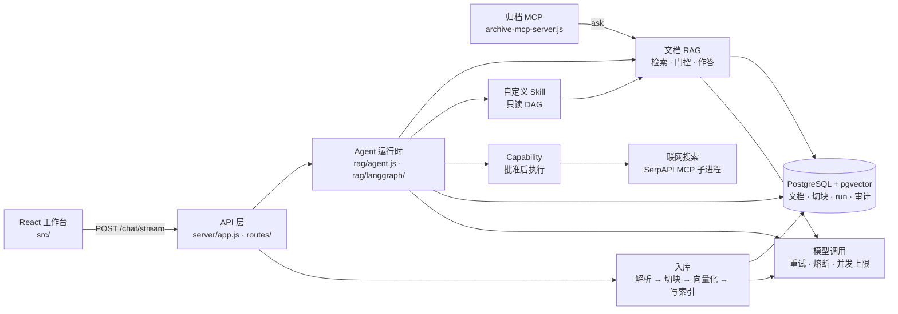

<div align="center">

# Luc1ferxx Archive RAG

**用 LangGraph.js 编排的受控文档 Agent：上传 PDF、Word、PowerPoint 或 Excel 后提问、对比、审查，文档回答附带页、幻灯片、工作表或章节级的出处。Agent 会按证据核对结论，但不是每条路径、每个短句都核对，也会漏放和误拒（见[当前限制](#当前限制)）。**

<p>
  <a href="https://github.com/luc1ferxx/Luc1ferxx_Archive_RAG/actions/workflows/quality-gate.yml"></a>
  <a href="https://github.com/luc1ferxx/Luc1ferxx_Archive_RAG/actions/workflows/real-model-eval.yml"></a>
</p>

[架构](#架构) · [代码结构](#代码结构) · [快速开始](#快速开始) · [测试与评测](#测试与评测) · [实测结果](#实测结果) · [当前限制](#当前限制) · [文档](#文档)

</div>

## 它是一个什么样的 Agent

一个受控的“规划-执行”Agent，只有一种运行时（LangGraph.js）：

- **模型决定什么**：默认（`AGENT_PLANNER_ROLLOUT=llm`）由模型在运行时给出的意图候选里选一个、排出外层计划，并用授权的只读 Skill 编一张小 DAG（每次运行最多两次 Skill 调用，最多重规划一次）。意图、外层计划和 Skill 图的模型调用失败或结果被校验拒绝时回退到规则，重规划失败就不再重规划。意图候选由正则规则生成，经验记忆可以补充和重排候选。没有让模型自由选工具的循环，模型封装也拒绝原生 tool calling。
- **运行时决定什么**：文档范围、权限、调用预算、并发和审批。联网搜索、导入、建待办、保存产物这类动作走到审批门就停下，本次请求以澄清结束，批准后另起一步执行。
- **现在做到什么程度**：用本地 7B 模型（`qwen2.5:7b`，不是默认配置的 gpt-5；温度、向量库等设置见[实测结果](#实测结果)）在同一批 QASPER 题（176 道可答、24 道不可答）上测：默认 Agent 答了 61 道可答题、误答 3 道不可答题；纯文档 RAG 是 101 和 10（在较早的提交上测的）。答了不等于答对；多步任务的成功率还没有用真实模型测过。
- **怎么做出来的**：早期用过 Codex（2026 年 4–7 月有 4 个来自 `codex/` 分支的 PR）；7 月下旬起主要是 Claude Code，9 月以来几乎每个提交都有它的署名，这期间的代码、测试、问题排查、评测和文档基本由它完成。作者定方向并拍板：只保留一种运行时是作者提出的要求；默认打开 claim 评审、让重排保持可选，是作者看过它给的数据和建议后的决定。

## 它能做什么

- **带出处的问答**：PDF 按页、Word（`.docx`）按章节、PowerPoint（`.pptx`）按幻灯片、Excel（`.xlsx`）按工作表定位，引用带文件名、位置和原文摘录，识别出标题时还带章节标题。可以对选中的文档或整个工作区提问；需要文档的问题涉及超过 12 份文档时，Agent 先请用户缩小范围。
- **多文档对比**：选了至少两份文档、问题命中对比的关键词规则时，按文档分别检索，差异绑定到各自的出处；证据近乎重复且没有冲突时给出“没有实质差异”。自定义 Skill 另有时间线、合同摘要和风险审查。
- **按证据核对**：普通文档问答作答后逐条核对结论，先按词法规则，被拒的一部分再由 LLM 评审复核；不过时补检索一轮，仍不过时一般请用户澄清，收尾时删掉仍没通过的结论。核对有漏放和误拒，也有不核对的路径，见[当前限制](#当前限制)。
- **可审批、部分可恢复的运行**：用 PostgreSQL 时，运行、步骤、审批和 Skill 图检查点都会落库；但重启后能自动续跑的只有很窄的一类 Skill 图运行，聊天里中断的普通问答要重问。
- **多租户**：开了 API 鉴权、凭据带用户或工作区时，按（用户, 工作区）隔离，PostgreSQL 行级安全兜底漏写的过滤条件；但没绑定工作区的凭据默认能用 `x-workspace-id` 自选工作区，要挡住得设 `TENANT_MEMBERSHIP=enforce`。可选 OIDC、RBAC、租户配额、租户数据导出和擦除、原始文件加密。
- **给其他 Agent 调用**：[`server/archive-mcp-server.js`](server/archive-mcp-server.js) 是 stdio MCP server，提供 `ask`、`list_documents`、`refresh` 三个工具，没有写入或入库工具；`ask` 走纯文档 RAG，不做 Agent 的核对。它由 MCP 客户端另起进程，读的是启动时的文档快照，工作台新上传的文档要先调 `refresh` 才看得到。

## 架构



API、Agent、入库和检索默认在一个进程里（`ARCHIVE_RAG_ROLE=all`），模型调用从这个进程直接发给 `OPENAI_BASE_URL`；归档 MCP 是 MCP 客户端另起的 stdio 进程，联网搜索时另起 SerpAPI MCP 子进程。设了 `ARCHIVE_RAG_ROLE` 和服务地址后，可以拆成 `api`、`agent`、`retrieval`、`model-gateway` 四种进程，层间用短期签名的内部身份，只有检索层和模型网关能加副本。拆分后上传的入库仍在 api 进程里做（异步模式下可交给 `npm run worker:ingest`），批准后执行的 arXiv 导入在 agent 进程里入库。 [拆分部署](docs/deployment.md#拆分部署可选)

### 一次请求怎么跑

1. **入口**：[`routes/chat.js`](server/routes/chat.js) 校验 `question`、`docIds`、`sessionId`，取请求的访问范围。`/chat` 和 `/chat/stream` 跑同一个 Agent，后者用 SSE 推送事件，工作台只用后者。[`app-services.js`](server/app-services.js) 的 `buildChatResponse` 对访问范围外的文档返回 404，再调用 [`rag/agent.js`](server/rag/agent.js) 的 `runAgentRag`。
2. **意图**：[`agent-intent-rules.js`](server/rag/agent-intent-rules.js) 用正则生成候选，最后总有 `document` 或 `document_web` 兜底，经验记忆可以补充和重排；默认由模型从候选 id 里选一个，失败时取排第一的候选（经验记忆重排之后）。
3. **执行前澄清**：对比却少于两份文档、需要文档却一份没选、需要文档且超过 12 份时，直接请用户澄清（[`agent-planner.js`](server/rag/agent-planner.js)）。
4. **外层计划**：模型（或规则）从 8 种固定步骤里排出计划，[`agent-execution-plan.js`](server/rag/agent-execution-plan.js) 校验，不合法就换成确定性计划。[`langgraph/execution-plan-graph.js`](server/rag/langgraph/execution-plan-graph.js) 把计划编成 LangGraph 的 Pregel 图，每个要执行的阶段一个节点、按顺序执行，某个阶段给出响应（例如澄清）就结束。
5. **阶段**：
   - **文档问答**（[`agent-document-loop.js`](server/rag/agent-document-loop.js)）：主检索后作答，流式客户端先收到通过词法核对的草稿句子或片段，最终结果到达后整体替换草稿；核对不过时补检索一轮，仍不过时一般转澄清。文档路线自己拒答时不补检索，一般改问是否批准联网搜索。
   - **自定义 Skill**（[`agent-custom-skill-stage.js`](server/rag/agent-custom-skill-stage.js)）：规划 typed DAG，节点只能是授权的自定义 Skill，整张图通过校验才执行，由 StateGraph 调度（[`langgraph/run-execution-graph.js`](server/rag/langgraph/run-execution-graph.js)）。图的上限是 12 个节点、深度 5、同时 3 个，但每个节点占一次 Skill 预算，默认一次运行最多执行 2 个；最多重规划一次。
   - **研究简报**（[`research-brief.js`](server/rag/research-brief.js)）：把问题套进 3 个固定的子问题模板，逐个走纯文档 RAG 检索作答，再按固定格式拼成简报（不另调模型汇总）。
   - **需要审批的动作**（[`capabilities/`](server/rag/capabilities)）：走到审批门时抛出中断，本次请求以澄清结束，run 进入 `waiting_for_user`。
6. **收尾**：[`agent-finalization-flow.js`](server/rag/agent-finalization-flow.js) 合成答案。普通文档问答先做词法核对，被拒的一部分再交 LLM 评审（对比答案不送评审），然后由 [`grounded-answer-finalizer.js`](server/rag/grounded-answer-finalizer.js) 按通过的结论重写答案，一条都不剩时换成拒答；用了自定义 Skill 结果或研究简报时只做词法核对。之后写回 run、经验记忆和会话记忆，SSE 推出 `result`（与 `/chat` 的响应相同）和 `done`。
7. **批准是另一次请求**：`POST /agent-runs/:runId/actions/approve` 校验审批哈希后，执行单独的 `capability_call` 步骤（[`agent-run-step-handlers/`](server/rag/agent-run-step-handlers)），结果不做 claim 校验。

### 运行状态、预算和审批

| | 实现 | 状态与边界 |
| --- | --- | --- |
| 外层计划 | LangGraph `Pregel`，按顺序调度校验过的阶段 | `checkpointer: false`，不重试。持久化靠应用记录的 run、步骤和审批：配了 PostgreSQL 就落库，否则在内存里。 |
| 自定义 Skill DAG | LangGraph `StateGraph`，节点带输入、输出契约 | 有 run 时检查点写进这条 run 的记录。启动恢复只自动续跑满足对账条件、外层计划只有这一步的 Skill 图。 |
| 审批 | 批准绑定动作输入快照的哈希 | 只有 run 在 `waiting_for_user`、审批门还是 pending 时能批准；批准后执行单独的 `capability_call` 步骤。 |
| 预算 | 每次运行默认：文档检索 2 次（含补检索）、自定义 Skill 2 次、联网 1 次、arXiv 导入 1 次、研究子问题 3 个，轨迹最多 16 步 | token（默认 10 万）、时长（默认 300 秒）和估算成本（默认 0.5 美元）是软上限，在文档检索、Skill 节点、联网、arXiv 导入、研究子问题开始前和重规划前检查，已经开始的调用会跑完。意图、外层计划和 Skill 图规划器以及 claim 评审的模型调用只计入用量；批准后执行的动作不计入。内置模型没有定价，默认配置下成本上限不会触发。 |

### 检索、作答和入库

**检索与作答**（入口是 [`rag/index.js`](server/rag/index.js) 的 `chat()`，主流程在 [`document-rag-execution.js`](server/rag/document-rag-execution.js)）：默认每个检索查询并行跑 pgvector 余弦和 PostgreSQL 里的 Okapi BM25 两路，用加权 RRF 融合，取前 10 条（Agent 按意图调整，例如时间线 9）。选了至少两份文档、问题命中对比的关键词规则（如 compare、区别、对比，或问哪份文档）时，按文档分别检索，每份文档默认 3 条（Agent 按意图取 2 或 4 条）。不按文档分别检索的问答由准入分、问题词覆盖率和问题里的锚点决定作答还是拒答；开了交叉编码器重排后改看重排概率（锚点仍要出现），重排服务失败时退回融合顺序和词面门控。纯文档 RAG 返回的引用是进入上下文的全部块，不只是答案里标了 `[Source N]` 的块。 [检索配置](docs/configuration.md#retrieval-配置) · [Hybrid 与重排](docs/configuration.md#hybrid-和-rerank)

**入库**：上传接口和 `npm run archive:ingest` 先按文件名初筛（直接上传还看 MIME 类型），不是 PDF、`.docx`、`.pptx`、`.xlsx` 的文件（例如 `.doc`、`.xlsm`）直接拒收（400）；再按文件字节判断格式，名字对、字节却是旧版 Office、设了打开密码的 Office 文件或启用宏的文件拒收（415）；设了打开密码的 PDF 能通过这一步，解析时才失败。PDF 默认用 pdf.js 解析（`PDF_PARSER` 可改成 `docling` 或逐页路由的 `auto`）。Office 默认在一个 worker 线程里解析：Word 按文档里最高一级的标题样式分节，PowerPoint 每张有文字的可见幻灯片一页（含标题和演讲者备注），Excel 每张有内容的可见工作表一页，按启发式选一行当表头，之后的行按它标注。然后切块（默认 900 字符、重叠 180）、向量化、写索引。默认在上传请求里同步完成（201）；`RAG_INGEST_MODE=async` 时返回 202，worker 按 parse → chunk → embed → index 四个阶段执行，各阶段单独重试，用尽后进死信。向量库默认 pgvector，另有 qdrant 和单机模式用的本地文件；索引版本的重建、切换和回滚只在 pgvector 上有。 [文档格式](docs/configuration.md#文档格式) · [数据生命周期](docs/data-lifecycle.md)

**多租户与安全**：API 鉴权默认关闭；关闭或只用一个共享的 `API_AUTH_TOKEN` 时没有租户隔离。开了鉴权、凭据带用户或工作区时，数据库语句在短事务里切到租户角色，由行级安全兜底漏写的过滤条件（不防 SQL 注入）。没绑定工作区的凭据默认可以用 `x-workspace-id` 自选工作区，要挡住得设 `TENANT_MEMBERSHIP=enforce`。OIDC、RBAC、租户配额、原始文件加密（KMS 只有本地实现）、读副本、Prometheus 指标和 OTel 追踪默认都关；admin 审计事件按哈希链写入，可用 `npm run audit:verify` 校验。 [租户隔离](docs/tenant-isolation.md)

## 代码结构

```text
.
├── src/                          # React 工作台（Vite + React 18 + antd；Vitest 测试和组件放在一起）
│   ├── App.jsx                   # 首页 + 三栏工作台：侧栏、预览、对话/轨迹/来源/任务
│   ├── archiveApi.js             # 业务 API 和 /chat/stream 的 SSE 客户端
│   ├── components/               # 首页、侧栏、输入框、回答与 run 面板、轨迹、预览、上传等
│   ├── hooks/                    # 会话、对话范围、文档、任务、审批与重试、运行恢复、arXiv 等
│   └── auth/                     # OIDC 授权码 + PKCE、token、工作区切换
├── server/
│   ├── server.js                 # 入口：按 ARCHIVE_RAG_ROLE 起单体或单个角色
│   ├── app.js                    # 中间件栈（helmet、CORS、跨站守卫、限流、鉴权、RBAC 等）+ 挂路由
│   ├── app-services.js           # 装配服务和规划器；buildChatResponse → runAgentRag
│   ├── routes/                   # HTTP 路由：chat、documents、uploads、tasks、admin、arxiv 等
│   ├── auth.js                   # token / JWT / OIDC 鉴权，解析（用户, 工作区）访问范围
│   ├── archive-mcp-server.js     # 给外部 Agent 的 stdio MCP：ask / list_documents / refresh
│   ├── chat-mcp.js, mcp-server.js  # 联网搜索：批准后起本地 SerpAPI MCP 子进程
│   ├── *.mjs                     # 命令行和独立进程：入库及异步 worker、索引版本、租户、备份、开发 IdP 等
│   ├── rag/
│   │   ├── agent.js              # 一次 Agent 请求的主干
│   │   ├── agent-intent-*.js     # 意图候选（正则 + 经验记忆）和选择
│   │   ├── agent-execution-plan*.js  # 外层计划的步骤、校验和各阶段执行
│   │   ├── langgraph/            # Pregel 外层图、Skill DAG 的 StateGraph、检查点、SSE 事件
│   │   ├── agent-document-loop.js    # 文档问答：核对，至多补检索一轮
│   │   ├── agent-custom-skill-stage.js, agent-execution-graph*.js  # Skill DAG 规划、校验、执行
│   │   ├── skills/               # Skill 注册表：7 个内置 Skill；custom/ 下 4 个只读 Skill
│   │   ├── capabilities/         # Capability 注册表、审批策略和审批执行快照
│   │   ├── self-check/           # 词法 claim 校验 + LLM claim 评审
│   │   ├── agent-finalization-flow.js, grounded-answer-finalizer.js  # 收尾
│   │   ├── agent-run*.js, agent-run-step-handlers/  # run 上下文、存储、状态机、恢复、审批后执行
│   │   ├── agent-tasks.js, job-orchestrator.js      # 后台任务：目标任务和 arXiv 导入
│   │   ├── memory.js, long-memory.js, agent-experience-memory.js  # 会话、长期和规划经验记忆
│   │   ├── index.js, document-rag-execution.js      # 文档 RAG 的 chat() 和主流程；入库各阶段、删除
│   │   ├── retrievers/, vector-store*.js, sparse-store.js  # 召回；pgvector / qdrant / local
│   │   ├── reranker.js, confidence.js, answer-writer.js, citations.js  # 重排、门控、作答、引用
│   │   ├── document-formats.js, document-loader.js  # 按字节判断格式、分派解析器
│   │   ├── pdf-*.js, docling-parser.js, office/     # PDF（pdf.js / Docling）和 Office 解析
│   │   ├── chunker.js, ingest-*.js, doc-registry*.js  # 切块、异步入库流水线和队列、文档注册表
│   │   ├── openai.js, model-call-guard.js, model-providers/  # 模型调用：重试、熔断、并发上限
│   │   ├── agent-service/, retrieval-service/, model-gateway/, service-*.js  # 拆分部署
│   │   ├── postgres*.js          # PostgreSQL 连接、租户上下文、读副本和各类存储
│   │   ├── tenant-*.js, rbac.js, oidc.js, kms/, admin-audit*.js  # 租户、权限、加密、审计
│   │   └── metrics*.js, tracing.js   # Prometheus 指标和 OTel 追踪
│   ├── db/migrations/            # 表、行级安全策略、租户与系统角色、检索函数
│   ├── evaluation/               # 评测和门禁；Compose 的交叉编码器重排服务也从这里构建
│   ├── test/                     # 后端测试（node --test）
│   └── scripts/                  # 一次性 PostgreSQL 集成测试、备份恢复、压测
├── deploy/                       # Prometheus 示例和规则、PostgreSQL 角色拆分 SQL、加固演示配置
├── Dockerfile, docker-compose.yml, compose.*.yml  # 单体、拆分、重排、加固演示
├── .github/workflows/            # quality-gate.yml、real-model-eval.yml
├── .opencode/                    # opencode 接归档 MCP 的配置
├── docs/                         # 设计、配置、部署、运维、评测文档和 LangGraph ADR
└── AGENTS.md                     # 给编码 Agent 的项目说明
```

## 快速开始

**Docker Compose**（API、前端和 PostgreSQL 一起启动）：

```bash
cp server/.env.example server/.env   # 至少填 OPENAI_API_KEY，或按下文改用本地模型
docker compose --profile app up -d --build
```

启动后打开 <http://localhost:5001>。Compose 发布的端口默认只绑 `127.0.0.1`；API 鉴权默认关闭，开放到局域网前先改数据库密码、开启鉴权。联网搜索需要 `SERPAPI_KEY`。 [端口与网络暴露](docs/deployment.md#端口与网络暴露)

**本地开发**（Node.js 22.13 及以上）：

```bash
npm install && (cd server && npm install)
cp .env.example .env && cp server/.env.example server/.env   # 启动前编辑 server/.env
docker compose up -d   # 只启动 PostgreSQL 16 + pgvector
npm run dev            # 前端 http://localhost:3000，后端 http://localhost:5001
```

原生启动的后端监听所有网卡，而鉴权默认关闭：同一网络里的机器能直接调用上传、删除、审批等接口。在不可信的网络里先开鉴权，或用防火墙挡住 5001 端口。

**本地模型（不花钱）**：装好 [Ollama](https://ollama.com)，运行 `ollama pull qwen2.5:7b` 和 `ollama pull nomic-embed-text`，在 `server/.env` 里设置：

```env
OPENAI_API_KEY=ollama
OPENAI_BASE_URL=http://127.0.0.1:11434/v1
OPENAI_CHAT_MODEL=qwen2.5:7b
OPENAI_EMBEDDING_MODEL=nomic-embed-text
RAG_EMBEDDING_DIMENSIONS=768
```

- 维度要显式写：不认识的 embedding 模型默认按 1536 维。pgvector 表里还没有块时按这个维度建列；已经用别的模型或维度入过库时，按[更换嵌入模型](docs/data-lifecycle.md#典型流程更换嵌入模型)的步骤建新的索引版本。
- 应用默认不设答案的温度和输出上限；把 `RAG_ANSWER_TEMPERATURE` 设成 0 时，同时设一个 `RAG_ANSWER_MAX_TOKENS`（例如 1024），本地 7B 在温度 0 时出现过一直生成到超时。
- 应用跑在 Docker 里时，`OPENAI_BASE_URL` 要写成 `http://host.docker.internal:11434/v1`（容器里的 127.0.0.1 不是本机）；Linux 上 Ollama 默认只监听 127.0.0.1，容器仍连不上，要用 `OLLAMA_HOST` 让它监听容器连得到的地址。

## 常用配置

| 开关 | 作用 |
| --- | --- |
| `DOCCOMPARE_STANDALONE=1` | 不连 PostgreSQL 单机试用（必须写 `1`）：文档和本地向量索引存文件，运行记录、任务和会话只在内存里，重启就丢；没有行级安全，只适合单租户。 |
| `AGENT_PLANNER_ROLLOUT=deterministic` | 意图、外层计划和 Skill DAG 都不调模型（意图取排第一的候选，经验记忆仍可能重排），不接重规划（默认 `llm`）。 |
| `RAG_INGEST_MODE=async` | 上传返回 202，由后台 worker 入库（默认跑在 API 进程里）。 [上传入库](docs/configuration.md#上传入库) |
| `RAG_DOCUMENT_FORMATS=pdf` | 服务端只收 PDF；工作台的上传框不读这个设置，仍能选 Office 文件，开始上传时被服务端拒绝（400）。 [文档格式](docs/configuration.md#文档格式) |
| `PDF_PARSER=auto` | pdf.js 先解析全部页，判为表格、扫描或乱码的页再交给 docling-serve；Docling 出错时默认保留 pdf.js 的文本。用 Docker Compose 时要写在命令前（`PDF_PARSER=auto docker compose ...`），写进 `server/.env` 会被 compose 的设置盖掉。 [版面解析](docs/deployment.md#版面解析可选) |
| `RAG_RERANK_ENABLED=true` + `RAG_RERANK_PROVIDER=cross-encoder` + `RAG_CROSS_ENCODER_ENDPOINT` | 调用另行启动的交叉编码器重排服务；不按文档分别检索的问答改按重排概率决定是否作答（问题里的锚点仍要出现）。 [重排配置](docs/deployment.md#交叉编码器重排可选推荐) |
| `API_AUTH_ENABLED=true` + `API_AUTH_TOKENS` | 按 token 鉴权，条目可以绑定用户和工作区；没绑定工作区的凭据能用 `x-workspace-id` 自选工作区，要挡住需设 `TENANT_MEMBERSHIP=enforce`。 [鉴权配置](docs/configuration.md#auth-和-access-scope) · [成员检查](docs/configuration.md#多租户治理) |
| `ARCHIVE_RAG_ROLE` | 拆分部署时这个进程跑 `api`、`agent`、`retrieval` 还是 `model-gateway`，另需服务地址和层间密钥。 [拆分部署](docs/deployment.md#拆分部署可选) |

其余变量见 [docs/configuration.md](docs/configuration.md)。

## 测试与评测

| 命令 | 作用 |
| --- | --- |
| `npm test` / `cd server && npm test` | 前端测试（Vitest）/ 后端测试（node --test；数据库集成测试缺 `PGVECTOR_TEST_DATABASE_URL` 时报告 skipped，不算通过） |
| `cd server && bash scripts/run-pgvector-integration.sh` | 用本机装的 PostgreSQL 和 pgvector 起一次性实例（不用 Docker），默认跑 `test:pgvector` 的集成测试；`FULL_SUITE=1` 跑整套后端测试（要 Redis、读副本或旧版本检出的套件仍报告 skipped） |
| `cd server && npm run coverage:gate` | CI 用的后端测试入口：跑同一套测试，再检查分组覆盖率下限 |
| `cd server && npm run eval:trajectory` | 确定性 Agent 轨迹评测：Skill 依赖、补检索、澄清、审批、预算、规划器回退、有界重规划等 |
| `cd server && npm run verify:quality` | 用真实模型检查纯文档 RAG 的问答、对比和拒答（不经过 Agent） |
| `cd server && npm run quality:current` | PR 质量门禁：不跑评测，检查当前检出和已有的评测报告（5 份必需，有 planner-real 报告时也查）是否都是同一提交的干净检出、报告是否 24 小时内生成 |
| `cd server && npm run eval:qasper-retrieval` / `eval:qasper-answers` | QASPER 证据召回 / 答案 F1；先下载 QASPER，再用 `corpus:qasper` 转换语料，参数见[评测文档](docs/evaluation.md#qasper外部标注的检索和答案评测) |
| `cd server && npm run funnel:qasper-answers` / `latency:qa` / `label:answers` | 不调模型：漏斗读纯文档 RAG 的答案报告和同设置的召回报告，耗时与 token 拆分读纯文档 RAG 串行运行的观测事件，标注页读答案报告和语料 |
| `cd server && npm run tenant:export` / `tenant:erase` / `backup:postgres` / `audit:verify` | 租户数据导出、擦除（默认只计数）、PostgreSQL 备份、审计哈希链校验 |
| `cd server && npm run vector:index -- status` | 查看 pgvector 索引版本 |

**CI**：[Quality Gate](.github/workflows/quality-gate.yml) 在 PR 和推到 main 时跑前端测试和构建，在 pgvector 服务容器上跑 `coverage:gate`，另一个并行的 job 跑确定性评测和 `quality:current`。[Real-model eval](.github/workflows/real-model-eval.yml) 每周一定时运行、也可手动触发，在 CPU runner 上用 Ollama 0.40.3 + `qwen2.5:7b` + `nomic-embed-text` 跑 `verify:quality`、QASPER 召回下限和输出上限探针（任一失败即失败），再跑 40 道 QASPER 答案题（只出报告）。`release:gate`、`robust:gate` 等其余门禁没有 workflow，要在本机手动跑。 [评测与门禁](docs/evaluation.md)

## 实测结果

下表是 2026 年 11 月 19–21 日的 QASPER 评测：同一批 200 题（176 道可答、24 道不可答），本地 `qwen2.5:7b` + `nomic-embed-text`，答案和 claim 评审的温度固定为 0、答案上限 1024 token（应用默认都不设），检索用的是 `local` 向量库，不是默认的 pgvector。三条路线来自不同提交，结果作描述性对照，没有配对判定。

| 路线 | 可答题作答数 / 176 | 不可答题误答数 / 24 | 可答题 F1（拒答计 0） |
| --- | ---: | ---: | ---: |
| 默认 Agent | 61 | 3 | 0.093 |
| Agent + 交叉编码器重排 | 84 | 8 | 0.123 |
| 纯文档 RAG | 101 | 10 | 0.118 |

默认 Agent 作答的 61 道可答题，纯文档 RAG 也都作答过。作答数只看给没给答案，答得对不对看 F1 或逐题核对。开重排在本机 MPS 上每题多约 4.4 秒；在 Apple M5 Pro 的 Docker Desktop（linux/arm64）CPU 容器里回放重排请求，只算重排每题 11.7 秒（15 核）或 24.6 秒（4 核），x86 服务器没有测过。

**编排**：`eval:trajectory` 用确定性用例检查 Agent 的编排行为，运行时关掉 claim 评审和记忆。Agent 在真实模型上的多步任务成功率还没测过。单文档事实题上，LLM 规划器和规则的作答数是 57/176 和 58/176，没有检出差异，LLM 每题多约 2.8 秒（当时 Agent 事实题只检索 4 块）；这 200 题里 198 题只有一个意图候选，所以测不出模型选意图的能力。

<details>
<summary>其他检索、质量与可靠性实验</summary>

下表横跨不同日期和配置。检索、答案和提示注入用本地模型，模型容错和行级安全分别用假模型服务和测试库。“显著”指配对 bootstrap 95% 区间不含 0。

| 实验 | 结果 |
| --- | --- |
| embedding 任务前缀 | QASPER dev 证据进入候选 0.648 → 0.692，显著 |
| 门控放行后，把更多候选段落放进上下文 | 证据进入模型上下文 0.245 → 0.353，显著 |
| 交叉编码器重排（2026-11-12，topK 10） | QASPER dev 证据进入候选 0.784 → 0.851，显著；可答题过门控 0.600 → 0.893；代价是不可答题被拦下 0.589 → 0.337，也显著 |
| 答案变短（prompt v2.2） | 答案 F1 0.206 → 0.231，显著 |
| 检索候选数 topK 6 → 10 | 证据进入模型上下文 0.361 → 0.407，显著；答案 F1 没有检出差异；输入 token 均值 +36%，本地 7B 作答 p50 1.75 → 2.40 秒，显著 |
| 文档问答漏斗（177 道可答题） | 证据没进候选 19%，进了候选但被拒答 32%，作答但证据没进上下文 6%，作答且证据在上下文里 44% |
| 纯文档 RAG 在进程内的耗时和 token（不含 HTTP、鉴权和数据库；本地 7B，串行） | 作答 p50 2.4 秒、p95 3.9 秒，99.5% 用在答案模型；拒答 17 毫秒；每次作答约 1,660 输入 + 66 输出 token |
| `verify:quality`（真实模型，纯文档 RAG） | 18/18 |
| 配了备用模型时，假模型服务上的主模型全部返回 503 | 成功率 0% → 100%（备用模型默认不配，而且和主模型走同一个端点） |
| 提示注入（13 个构造用例 × 3 轮） | 纯文档 RAG 攻击进入答案 17/39 → 0/39；Agent 路径 4/39 → 0/39（Agent 多以澄清结束，要打折看） |
| 行级安全 | 漏写过滤条件时泄露的表 9/9 → 0/9 |

embedding 前缀、候选进上下文和答案变短三项测于 2026-10-04 切块改动之前（当时默认 topK 为 6），当前设置下没有重测；topK 一行的证据结果测于 2026-10-29，它的 token 和耗时代价、漏斗、纯 RAG 耗时测于 2026-11-10。BM25 和 `ts_rank_cd` 没有检出显著差异，默认用 BM25 是产品选择。 [完整评测、设置和区间](docs/evaluation.md)

</details>

## 当前限制

- **模型和测量范围**：上面真实模型的数字都来自单机上的本地模型（作答用 `qwen2.5:7b`），没有生产流量；不改配置时用的 gpt-5 和 text-embedding-3-small 只在 2026-04-21 的早期版本上跑过两份很小的合成语料（报告在 `server/evaluation/results/`），没有在 QASPER 或当前的 Agent 上测过。真实模型的答案评测和大部分检索评测（QASPER、`verify:quality`、提示注入）都在单机模式的 `local` 向量库上跑，只有稀疏路打分的召回对照（BM25 对 `ts_rank_cd`）用了 pgvector；答案评测没有在默认的 pgvector 路径上跑过。成本只量了每次问答的 token 数，没有真实账单；真实模型的延迟都是单机串行的数字，并发下的延迟只用假模型压测过。
- **评测**：外部标注只用了 QASPER，没有人工标注的黄金集（标注页能生成了，还没有人标）；claim 的 LLM 评审默认打开，但没有用人工标注校准过，默认和作答用同一个模型；评测记录里逐题判对错的“独立评审”是 AI 代理，不是人。答案评测 2026-11-10 起温度固定为 0，但 CI 上同样设置的两次运行答案也不一致，小幅变化不能当作效果。
- **Agent 答得少，答了也常常不对**：词法校验对改写很严；默认打开 LLM 评审和来源继承之后，约三分之二的可答题仍以澄清（包括改问是否联网）或拒答结束，在上面那批题上，答出来的也都是纯文档 RAG 答出过的。之前一版（提交 db6a7d22）的 61 个回答（57 道可答、4 道不可答）由 AI 代理逐题判过，只有 25 个完全答对。意图候选主要由关键词规则生成：换一种说法可能选不到对应的动作；含“续约”“终止”这类词的普通问题可能被排进合同摘要 Skill，范围里有多份文档时（工作台默认带上全部上传文档），含“分析”“报告”“不同”这类词的问题也可能走对比 Skill 或研究简报。这些路线只做词法核对、不补检索。
- **核对的已知缺口**：
  - 完整流程是给 Agent 普通文档问答的。按对比作答时没有 LLM 复核；用自定义 Skill 结果收尾时只做词法核对；研究简报只核对其中已完成的发现；MCP `ask`、人工重试的步骤和批准后执行的动作不走 Agent 的核对。
  - 全由停用词组成、没有数字的英文句子可能不经真正核对就通过（停用词里也有 same、policy、conflict 这类词）：没标出处时直接跳过，例如开头一句 `It is not.` 或 `They are not the same.` 会随后面有据的句子一起交付；标了出处也可能空过，例如问是不是 99 天，原文是 12 天，答 `Yes [Source 1].` 照样通过。
  - 被判成要联网的问题（例如带“最新”“今天”）等待批准时，文档路线的原答会直接显示，核对没通过也一样；拒绝联网或批准后搜索失败时仍然留着。
  - 最终事件和运行记录的轨迹里会留着没通过核对的原文，普通问答改成澄清时也一样，工作台的轨迹区会显示。
- **恢复和审批的已知缺口**：
  - 自动续跑只在 `auto` 恢复模式（用 PostgreSQL 时的默认）下发生，至少要同时满足：外层计划只有 Skill 图一步、图还没跑完、当前图里没有正在执行或失败的节点、没有待批的审批、检查点对得上。运行也没有租约，另一个 Agent 进程启动时会把正在跑的运行当成中断的处理。
  - 默认恢复模式下，重启一般会把还在等澄清或批准的运行也标成待人工。带着跑完的 Skill 图等批准的运行被标过之后，再批准会先执行动作、再报错并停在 `running`；续跑途中再次中断的图也会一直停在 `running`。
  - 已批准的单个动作执行到一半中断时不会重做，是否生效不确定。排队和中断的后台任务不论恢复模式都会重新调度，有执行器的会再跑：已批准、还没生成完的产物沿用原批准整组再做，只靠幂等键去重；停在已批准的单个动作里的任务会记为失败。
  - 原批准能被重复使用：重试接口能再执行一次已经成功的动作（失败后重试成功过的，工作台的“重试”按钮也能），而且不是每种动作都去重（例如外部导入会留下重复的任务）。
  - 会话、记忆和运行记录自动写入；模型调用和用户直接发起的操作（上传、导入、删除等）不走审批。默认不开鉴权，能访问 API 的调用方都能批准。
- **拒答**：判断证据够不够的信号不强：不开重排时，词面和余弦的 AUC 约 0.59–0.66；开重排时，重排概率在 train 上是 0.648、dev 上是 0.724。既会拒掉不少可答题，也会回答一部分不可答题。
- **Office 文件**：只取文字，页眉页脚、批注、图表、SmartArt 和图片都不提取，也不做 OCR；工作台里没有 Office 内联预览，点到 Office 引用时预览栏给原件下载和被引用的原文；效果只和 Office 自己导出的 PDF 对比过一轮（合成表格上答对率高 0.093，Word 和 PPT 的正文题没检出差别），真实业务文件没有量过。默认的问答和对比答案 prompt 里仍写着 “uploaded PDFs”（改了会改变这几个模板的指纹，要和固定的基线重新对照）。
- **安全**：鉴权默认关闭，原生启动的后端监听所有网卡；没绑定工作区的凭据默认能自选工作区。行级安全只约束切到租户角色的语句，防的是漏写过滤条件，不防 SQL 注入，Docker 默认用 postgres 超级用户连库；提示注入筛查是模式匹配，挡不住刻意改写；加密覆盖原始文件和入库中间产物，检索用的切块文本和向量、运行记录、反馈和记忆都是明文，KMS 只有演示用的本地实现；OIDC 只在内置的开发 IdP 上端到端测过。
- **规模**：所有压测都在一台机器上、用假模型；`compose.services.yml`（按层拆分）只在一台机器上手动构建并启动过一次（2026-11-20），CI 不构建它；告警规则只做过静态检查，没在真实的 Prometheus 里跑过。多开实例时，每个实例启动都会把别的实例正在跑的运行当成中断的处理（一般转成待人工）；arXiv 推荐快照和按 IP 限流按进程各算一份，上传认领按进程 PID 判断，多实例共享上传目录时会误判；拆分部署时 api 和 agent 各只能跑一个。

更细的限制写在各文档里。

## 文档

| 文档 | 内容 |
| --- | --- |
| [Agent RAG 设计](docs/agent-rag.md) | 回答闭环、Skill 与 typed DAG、claim 核对、流式、预算、恢复语义 |
| [LangGraph ADR](docs/adr/0001-langgraph-runtime.md) | 迁到 LangGraph.js 的决策、各阶段结果、只保留一种运行时的代价 |
| [检索调优](docs/retrieval-tuning.md) | BM25 与常见词剪枝、语义答案缓存、查询适配器 |
| [数据生命周期](docs/data-lifecycle.md) | 索引版本的重建、切换和回滚，分阶段异步入库 |
| [评测](docs/evaluation.md) | 评测命令、质量门禁和大部分改前 / 改后数字 |
| [配置](docs/configuration.md) | 环境变量和默认值 |
| [部署](docs/deployment.md) | Docker Compose、拆分部署、重排、OIDC 与 RBAC、读副本、指标 |
| [运维](docs/operations.md) | SLO、告警处理、备份与恢复 |
| [租户隔离](docs/tenant-isolation.md) | 多租户模型、分层防御和限制 |
| [加固演示](docs/demo-tenant-isolation.md) | `compose.demo.yml` 的加固部署演示 |
| [开发](docs/development.md) | API、本地 PostgreSQL、开发约束 |
| [统一 DAG 的历史](docs/unified-agent-dag-migration.md) | 已删除的 v3 统一图做过什么、为什么删 |
