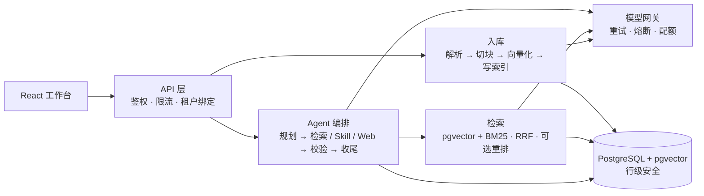

<div align="center">

# Luc1ferxx Archive RAG

**可信文档智能体：上传 PDF 后提问、对比、审查，每个结论都能追溯到页级证据；证据不够就补检索、澄清或拒答。**

<p>
  <a href="https://github.com/luc1ferxx/Luc1ferxx_Archive_RAG/actions/workflows/quality-gate.yml"></a>
  <a href="https://github.com/luc1ferxx/Luc1ferxx_Archive_RAG/actions/workflows/real-model-eval.yml"></a>
</p>

[快速开始](#快速开始) · [架构](#架构) · [实测结果](#实测结果) · [文档](#文档) · [当前限制](#当前限制)

</div>

## 它能做什么

- **带出处的问答**：在选中的文档或整个工作区里提问，回答附带页码、摘录和来源文件。
- **多文档对比**：每份文档单独检索，差异绑定到各自的出处，也能识别"没有实质差异"。
- **证据不够不硬答**：逐条检查结论有没有证据支持，必要时补检索一轮、请用户澄清或拒答。
- **可恢复的 Agent 运行**：运行、审批和检查点存在 PostgreSQL，崩溃后可以从检查点恢复；状态不明的步骤转人工处理，不会自动重放；有副作用的动作要人工审批。
- **多租户**：PostgreSQL 行级安全兜底，可选 OIDC 登录、RBAC、租户配额、租户数据导出和删除、原始文件加密。
- **按需扩展**：默认一个进程加一个 PostgreSQL；可以异步入库、多实例、按层拆分部署，也能作为只读的 MCP server 给其他 Agent 调用。

## 快速开始

**Docker 一键部署**（API、前端和 PostgreSQL 一起启动，打开 http://localhost:5001）：

```bash
cp server/.env.example server/.env   # 至少填 OPENAI_API_KEY，或按下面改用本地模型
docker compose --profile app up -d --build
```

端口默认只绑定 `127.0.0.1`。要在局域网里访问，先改数据库密码、开启 API 鉴权并换掉 `.env.example` 里的示例 token，见 [docs/deployment.md](docs/deployment.md#端口与网络暴露)。

**本地开发**（Node 22.13 及以上）：

```bash
npm install && (cd server && npm install)
cp .env.example .env && cp server/.env.example server/.env
docker compose up -d   # 只启动 PostgreSQL 16 + pgvector
npm run dev            # 前端 http://localhost:3000，后端 http://localhost:5001
```

**用本地模型（不花钱）**：装好 [Ollama](https://ollama.com)，`ollama pull qwen2.5:7b` 和 `ollama pull nomic-embed-text`，然后在 `server/.env` 里设置：

```env
OPENAI_API_KEY=ollama
OPENAI_BASE_URL=http://127.0.0.1:11434/v1
OPENAI_CHAT_MODEL=qwen2.5:7b
OPENAI_EMBEDDING_MODEL=nomic-embed-text
RAG_EMBEDDING_DIMENSIONS=768
```

用 Docker 部署时，`OPENAI_BASE_URL` 要写成 `http://host.docker.internal:11434/v1`（容器里的 127.0.0.1 不是本机）。

**常用开关**（完整列表见 [docs/configuration.md](docs/configuration.md)）：

| 开关 | 作用 |
| --- | --- |
| `DOCCOMPARE_STANDALONE=1` | 不连 PostgreSQL 单机试用：文档存本地文件，运行记录和任务只在内存里，不做租户隔离 |
| `RAG_INGEST_MODE=async` | 上传立即返回 202，由后台 worker 入库 |
| `PDF_PARSER=auto` | 表格页和扫描页交给 Docling，其余页用 pdf.js（需要 docling-serve，见 [docs/deployment.md](docs/deployment.md#版面解析可选)） |
| `RAG_RERANK_ENABLED=true` + `RAG_RERANK_PROVIDER=cross-encoder` + `RAG_CROSS_ENCODER_ENDPOINT` | 交叉编码器重排（需要重排服务，见 [docs/deployment.md](docs/deployment.md#交叉编码器重排可选推荐)） |
| `API_AUTH_ENABLED=true` + `API_AUTH_TOKENS` | 按 token 鉴权并区分用户和 workspace；OIDC 和 RBAC 见 [docs/deployment.md](docs/deployment.md#oidc-登录和-rbac可选) |
| `ARCHIVE_RAG_ROLE=api\|agent\|retrieval\|model-gateway` | 按层拆分部署时这个进程跑哪一层，还要配服务地址和层间密钥，见 [docs/deployment.md](docs/deployment.md#拆分部署可选) |

## 架构



一次请求：API 鉴权并绑定租户 → 规划器在白名单内选意图和步骤 → 检索文档、执行 Skill 或 Web 搜索 → 逐条校验结论，必要时补检索一轮 → 删掉没有证据的内容后返回；流式接口只推送校验过的整句。

几条设计原则：

- **模型只提议，运行时做决定**：权限、文档范围、预算、审批和并发都由运行时决定，规划器只能在白名单里选。
- **一切有上限**：补检索最多一轮，重规划最多一次；每次运行都有 token、成本和时长上限，超限时降级而不是报错。
- **默认单进程**：图里的各层默认都在一个进程里；设了 `ARCHIVE_RAG_ROLE` 和服务地址后，每层可以是独立进程、单独加副本，层间用签名的内部身份通信。

代码结构见 [docs/development.md](docs/development.md#仓库结构)。

## 常用命令

| 命令 | 作用 |
| --- | --- |
| `npm run dev` | 同时启动前端和后端 |
| `npm test` / `cd server && npm test` | 前端测试 / 后端测试 |
| `cd server && bash scripts/run-pgvector-integration.sh` | 在一次性 PostgreSQL 上跑数据库集成测试（用本机装的 PostgreSQL 和 pgvector，不用 Docker） |
| `cd server && npm run verify:quality` | 用真实模型检查问答、对比和拒答 |
| `cd server && npm run quality:current` | PR 质量门禁（只检查当前提交的评测报告，要先跑评测） |
| `cd server && npm run eval:qasper-retrieval` / `eval:qasper-answers` | QASPER 证据召回 / 答案 F1（先下载 QASPER 并用 `corpus:qasper` 生成语料） |
| `cd server && npm run vector:index -- status` | 查看索引版本 |

全部评测命令和门禁规则见 [docs/evaluation.md](docs/evaluation.md)。

## 实测结果

检索、答案和提示注入的数字来自本地 7B 模型（`qwen2.5:7b` + `nomic-embed-text`），模型容错和行级安全用的是假模型服务和测试库；都在单台机器上，没有生产流量。"显著"指配对 bootstrap 95% 区间不含 0。QASPER 的前四行是在 2026-10-04 切块改动之前、默认 topK 还是 6 时测的，当前设置下没有重测；topK 那一行是 2026-10-29 在当前的块上测的。

| 项目 | 结果 |
| --- | --- |
| embedding 任务前缀 | QASPER dev 证据进入候选 0.648 → 0.692，显著 |
| 决定作答后，把更多候选段落放进上下文 | 证据进入模型上下文 0.245 → 0.353，显著 |
| 交叉编码器重排（可选，默认关） | 证据进入上下文 0.353 → 0.417，显著 |
| 答案变短（prompt v2.2） | 答案 F1 0.206 → 0.231，显著 |
| 检索候选数 topK 6 → 10（现在的默认） | QASPER dev 证据进入模型上下文 0.361 → 0.407，显著；答案 F1 没有检出差异，模型多读约六成上下文 |
| `verify:quality`（真实模型，走 RAG 问答路径，不经过 Agent） | 18/18 |
| 主模型宕机时切备用模型 | 成功率 0% → 100% |
| 提示注入（13 个攻击 × 3 轮） | 攻击进入答案 17/39 → 0/39 |
| 行级安全 | 漏写过滤条件时泄露的表 9/9 → 0/9 |

BM25 和 `ts_rank_cd` 没有显著差异，默认用 BM25 是产品选择。测了但没采用的方案（Docling、提高答题率的开关等）、区间和全部数字见 [docs/evaluation.md](docs/evaluation.md)。

## 文档

| 文档 | 内容 |
| --- | --- |
| [docs/agent-rag.md](docs/agent-rag.md) | Agent 闭环、Skill 与执行图、校验、流式、预算 |
| [docs/retrieval-tuning.md](docs/retrieval-tuning.md) | BM25 与常见词剪枝、语义缓存、查询适配器 |
| [docs/data-lifecycle.md](docs/data-lifecycle.md) | 分阶段入库、索引版本的重建、切换和回滚 |
| [docs/evaluation.md](docs/evaluation.md) | 评测命令、质量门禁、所有改前 / 改后数字 |
| [docs/configuration.md](docs/configuration.md) | 环境变量 |
| [docs/deployment.md](docs/deployment.md) | Docker 部署、拆分部署、OIDC 和 RBAC、读副本、指标 |
| [docs/operations.md](docs/operations.md) | SLO、告警处理、备份与恢复 |
| [docs/tenant-isolation.md](docs/tenant-isolation.md) | 多租户隔离的设计和限制 |
| [docs/development.md](docs/development.md) | API、仓库结构、开发约束 |

## 当前限制

- **模型**：真实模型的数字只来自本地 7B 模型，没有 GPT 级模型、生产流量或真实成本数据。
- **评测**：外部标注只用了 QASPER，没有人工标注的黄金集；LLM 评审没有在真实数据上校准过，默认关闭。
- **校验偏严**：默认的词法校验对改写很严，Agent 路径常常转为请用户澄清；为提高答题率试过的开关都没通过事先定的规则，保持关闭。
- **拒答**：判断证据够不够的信号很弱（AUC 约 0.59–0.64），既会拒掉不少可答题，也会回答一部分不可答题。
- **安全**：提示注入筛查挡不住刻意改写；行级安全防的是漏写过滤条件，不防 SQL 注入；加密只覆盖原始文件，切块文本和向量是明文，KMS 只有演示用的本地实现；OIDC 只在内置的开发 IdP 上端到端测过。
- **规模**：所有压测都在一台机器上、用假模型；`compose.services.yml`（按层拆分）还没真正构建和启动过；告警规则没在真实的 Prometheus 里跑过。

各部分更细的限制写在对应文档的"限制"一节。
